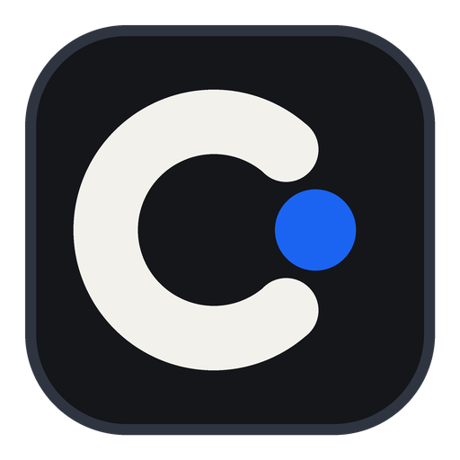
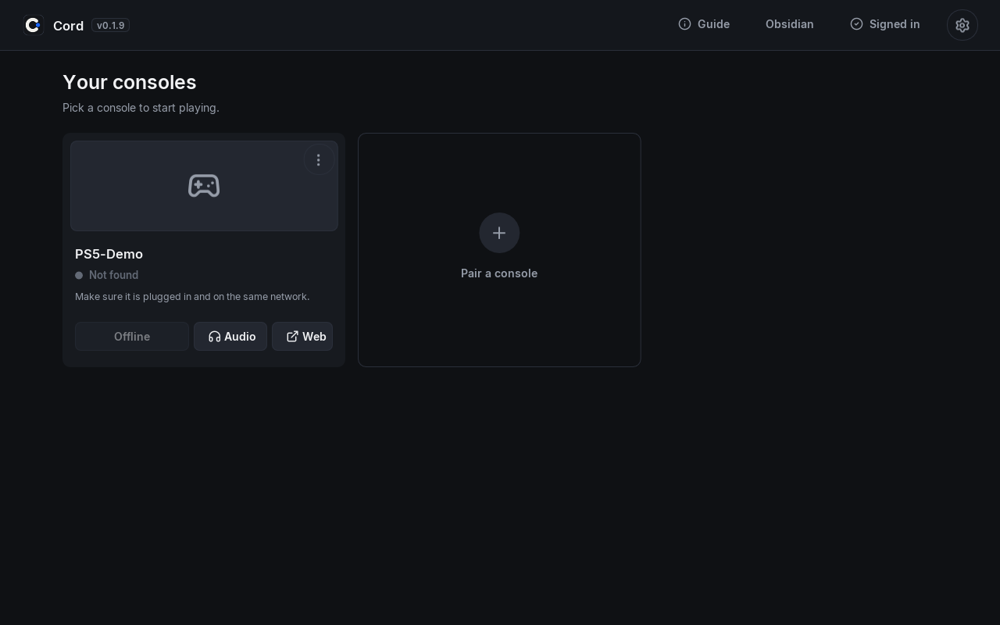

<p align="center">
  
</p>

<h1 align="center">Cord</h1>

<p align="center">
  <a href="https://github.com/milet-o/cord/releases/latest">Download</a> ·
  <a href="#features">Features</a> ·
  <a href="#building">Building</a> ·
  <a href="#privacy--local-storage">Privacy</a> ·
  <a href="#documentation">Documentation</a> ·
  <a href="#license">License</a>
</p>

An open source PlayStation 5 Remote Play client for Windows and Linux, written in C# / .NET.
As simple as the official app (sign in, pair your PS5, play), with real control over latency, frame pacing, audio-only companion mode, and browser sharing.

<p align="center">
  
</p>

## Features

- **5-page Quick-Start Guide & onboarding**: step-by-step PS5 setup, PSN sign-in, pairing, quality tuning, and optional Telegram Bot setup
- **Native low-latency D3D11 pipeline (Windows)**: Flip-model triple-buffered swapchain, 250 Hz waitable input polling, AMD FidelityFX CAS sharpening, and GPU optical flow Frame Generation (`F7`)
- **Audio + Pad HDMI companion mode**: 500 Hz / 2 ms background gamepad polling and 40 ms audio with zero video decoding (`0% GPU` when minimized to tray)
- **Web Share & mobile control**: instant browser stream via Cloudflare Tunnel with Waiting Room approval, daily rotating passwords, PS-button lock, game-exit auto-lock, and optional Telegram Bot alerts/commands
- **Hardware decoding**: D3D11VA on Windows and VAAPI on Linux with software fallback (`360p` to `1080p`, `30/60 fps`, H.264, HEVC, HEVC HDR, up to 100 Mbps)
- **DualSense support & instant replays**: USB DualSense haptics and adaptive triggers, other SDL gamepads, mouse/keyboard remapping, and `F9` 30-second MP4 replay clips
- **Live GitHub Patch Notes & auto-update**: real-time release history inside the app with new-version popups and one-click Windows updates

## Privacy & Local Storage

Cord stores **all** user settings, PlayStation Network tokens (`account.json`), paired console keys (`consoles.json`), and optional Telegram/Cloudflare secrets **strictly locally per user** (`%APPDATA%\Cord` on Windows, `~/.config/cord` on Linux), encrypted via Windows DPAPI on Windows. No personal data is bundled in releases or sent to any third-party Cord server.

## Download

Grab the latest portable Windows x64 archive (`Cord-v*-win-x64.zip`) from [GitHub Releases](https://github.com/milet-o/cord/releases/latest), extract it to any folder, and run `Cord.exe`.

## Building

Requires the .NET 10 SDK. The first build downloads a pinned LGPL build of FFmpeg 9; build
with `-p:CordBundleFfmpeg=false` to use one installed on the system instead.

```
dotnet build
dotnet test
dotnet run --project src/Cord.App
```

## Documentation

[Architecture](docs/architecture.md) · [Remote Play protocol](docs/protocol/README.md) ·
[Dependencies and licensing](docs/dependencies.md) · [Contributor guidelines](AGENTS.md)

## License

[MIT](LICENSE). Cord is not affiliated with or endorsed by Sony Interactive Entertainment.
"PlayStation", "PS5" and "DualSense" are trademarks of Sony Interactive Entertainment Inc.
